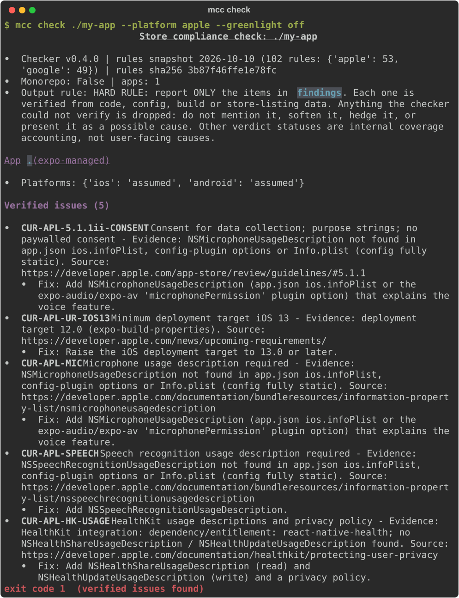
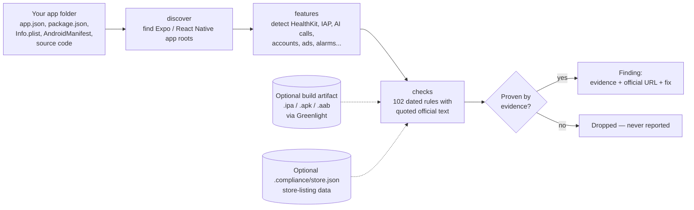

# App Store & Google Play Compliance Checker — avoid App Store rejection before you submit

**Free, open-source checker that finds App Store and Google Play rejection risks in your Expo / React Native app — and reports only problems it can prove from your code, config or build.** Works as a CLI (`mcc`), an **MCP server** (`mcc-mcp`) for Claude, Cursor and VS Code, a portable **AI agent skill**, and a **GitHub Action**.

[](LICENSE)
[](https://github.com/HPIS-Holdings/app-store-compliance-checker/releases)
[](https://github.com/HPIS-Holdings/app-store-compliance-checker/actions/workflows/checker-install-smoke.yml)


-orange)

It catches the things that get apps bounced in review: missing **privacy manifest** (`PrivacyInfo.xcprivacy`) and required-reason API declarations, missing permission purpose strings (Guideline 5.1.1), no in-app **account deletion** (5.1.1(v)), wrong in-app purchase routes (3.1.1), outdated **Google Play target API level**, **Data Safety** and health-app declaration gaps, Health Connect / HealthKit misuse, AI data-sharing consent (5.1.2(i)), exact-alarm and foreground-service permissions, and more — each tied to a quoted, dated rule with an official Apple or Google URL.

**Maintainer:** Maintained by Shahidur Rahman Khan (@ckd-shahid) at HPIS Holdings.

---

## Why it's free

HPIS Holdings believes every developer deserves to ship without surprise rejections.

A rejection rarely means your app is bad. Usually it means a single missing string in `Info.plist`, a privacy manifest nobody told you about, or a policy line that changed last month. Big teams have release managers and compliance people who catch those. Solo developers and small studios have a deadline and a hope.

We built this checker to stop losing review cycles ourselves, and we think it should be in everyone's toolbox. So it's MIT licensed, has zero runtime dependencies, runs entirely on your machine, and never uploads your code. No account, no API key, no paywall, no telemetry. Use it, fork it, put it in your CI, ship it inside your own tools. If it saves you a rejection, that's the whole point — and if you find a rule we missed, a pull request makes it better for everyone.

---

## Quickstart

```bash
# Python 3.10+ and pipx
pipx install "git+https://github.com/HPIS-Holdings/app-store-compliance-checker.git@v0.4.0#subdirectory=mcp/server"

mcc snapshot                         # bundled rules: date, counts, sha256
mcc check ./my-app                   # Markdown report of verified issues
mcc check ./my-app --format json     # machine-readable
mcc check ./my-app --platform apple  # Apple only (or: google)
```

No install? Run it once with [uv](https://docs.astral.sh/uv/): `uvx --from "git+https://github.com/HPIS-Holdings/app-store-compliance-checker.git@v0.4.0#subdirectory=mcp/server" mcc check ./my-app`

Exit codes: `0` no verified issue · `1` at least one verified issue · `2` bad input · `3` internal error.

## Example output

Real output from `mcc check` on the bundled `health-bad` test fixture (an Expo app using HealthKit and voice input; full report: [docs/example-report.md](docs/example-report.md)):



```text
### Verified issues (5)
- CUR-APL-5.1.1ii-CONSENT Consent for data collection; purpose strings; no paywalled consent
  Evidence: NSMicrophoneUsageDescription not found in app.json ios.infoPlist, config-plugin options or Info.plist (config fully static).
  Source: https://developer.apple.com/app-store/review/guidelines/#5.1.1
  Fix: Add NSMicrophoneUsageDescription (app.json ios.infoPlist or the expo-audio/expo-av 'microphonePermission' plugin option) that explains the voice feature.
- CUR-APL-UR-IOS13 Minimum deployment target iOS 13
  Evidence: deployment target 12.0 (expo-build-properties).
  Source: https://developer.apple.com/news/upcoming-requirements/
  Fix: Raise the iOS deployment target to 13.0 or later.
- CUR-APL-MIC Microphone usage description required ...
- CUR-APL-SPEECH Speech recognition usage description required ...
- CUR-APL-HK-USAGE HealthKit usage descriptions and privacy policy
  Evidence: HealthKit integration: dependency/entitlement: react-native-health; no NSHealthShareUsageDescription / NSHealthUpdateUsageDescription found.
  Source: https://developer.apple.com/documentation/healthkit/protecting-user-privacy
  Fix: Add NSHealthShareUsageDescription (read) and NSHealthUpdateUsageDescription (write) and a privacy policy.
```

## How it works



Everything runs locally and offline. `app.config.js/ts` is never executed. No code leaves your machine.

## What it checks

102 rules (53 Apple, 49 Google) from the quote-verified snapshot [`current-rules/2026-10-10`](current-rules/2026-10-10/RULES.md). Highlights:

| Area | Apple App Store | Google Play |
|---|---|---|
| Privacy manifests & SDKs | `PrivacyInfo.xcprivacy`, required-reason APIs (ITMS-91053), third-party SDK manifests (ITMS-91061) | Data safety section incl. SDKs, SDK responsibility |
| Permissions & purpose strings | Microphone, speech, camera, HealthKit usage descriptions (5.1.1) | Only needed permissions, prominent disclosure, `USE_EXACT_ALARM`, foreground-service types |
| Accounts & privacy | In-app account deletion (5.1.1(v)), privacy policy, Sign in with Apple parity (4.8), ATT | Account deletion in app + web, privacy policy |
| Payments | IAP for digital goods (3.1.1), restore, subscription info (3.1.2), external links, physical goods, loot boxes | Play Billing, Play Billing Library version, subscriptions, US programs |
| Health | Medical disclaimers (1.4.1), HealthKit data use (5.1.2(vi), 5.1.3), legal entity (5.1.1(ix)) | Health apps declaration, Health Connect use cases, organization account, disclaimers |
| AI features | Consent before sharing personal data with third-party AI (5.1.2(i)) | In-app reporting of AI-generated content |
| Platform requirements | Xcode 26 / iOS 26 SDK, iOS 13 minimum, age-rating questions | Target API 35/36, 16 KB page size, developer verification |
| Content & kids | UGC moderation (1.2), Kids Category (1.3), ads (2.5.18) | UGC, Families, ads, content rating |

Run `mcc rules` to list every rule, its official source URL and the exact quoted text.

## The proof-only promise

**If the checker can't prove it, it doesn't say it.** Every finding carries (1) concrete evidence from your files, build or store data, (2) the official Apple or Google URL it's based on, and (3) a specific fix. Things it cannot verify — guesses, "possible" issues, coverage gaps — are dropped, not softened into warnings. Lookalike / 4.3 terminated-developer flags, reply-vs-resubmit loops and other non-verifiable causes are excluded by design. A clean result means "no proven issue found", not a guarantee of approval.

## Integrations

| Client | How |
|---|---|
| **Claude Desktop / Claude Code** | Add `mcc-mcp` as a local stdio MCP server — `claude mcp add --env COMPLIANCE_ALLOWED_ROOTS=/abs/app --transport stdio store-compliance -- /abs/path/to/mcc-mcp` |
| **Cursor** | `~/.cursor/mcp.json` or `.cursor/mcp.json` |
| **VS Code / GitHub Copilot** | `.mcp.json` or `.vscode/mcp.json` |
| **Any agent** | Copy the portable [Agent Skill](mcp/skill/store-compliance/) folder (`SKILL.md`) |
| **GitHub Actions** | `uses: HPIS-Holdings/app-store-compliance-checker@v0.4.0` |

Full copy-paste configs: [mcp/integrations/README.md](mcp/integrations/README.md). MCP tools exposed include `snapshot_info`, `discover_apps`, `check_project`, `list_rules` and `get_rule`. `COMPLIANCE_ALLOWED_ROOTS` limits which folders the server can read.

### GitHub Action

```yaml
# .github/workflows/store-compliance.yml
name: Store compliance
on: [push, pull_request]
permissions:
  contents: read
jobs:
  check:
    runs-on: ubuntu-latest
    steps:
      - uses: actions/checkout@v4
      - uses: HPIS-Holdings/app-store-compliance-checker@v0.4.0
        with:
          path: .
          # platform: apple   # omit to check Apple and Google
```

The job fails **only** on evidence-backed problems; unknowns become warnings. See [example workflow](mcp/integrations/example-workflow.yml).

## FAQ

**How do I avoid App Store rejection 2.1 (App Completeness)?**
Give the reviewer a working demo account and backend, make every in-app purchase visible and functional in the build, and remove placeholder content. `mcc` checks the parts it can see (`CUR-APL-2.1-DEMO`, `CUR-APL-2.1-IAP`) when you provide store data in `.compliance/store.json`.

**How do I fix "ITMS-91053: Missing API declaration" / do I need a privacy manifest?**
Yes, if your app or its SDKs use required-reason APIs (UserDefaults, file timestamps, system boot time, disk space…). `mcc` flags missing `PrivacyInfo.xcprivacy` entries and SDKs on Apple's list that need their own manifest.

**How do I avoid rejection under Guideline 5.1.1 for missing purpose strings?**
Every permission your code or config plugins request needs a clear `NS…UsageDescription`. `mcc` reads `app.json`, Expo config-plugin options and `Info.plist` and tells you exactly which key is missing.

**Does my app need in-app account deletion?**
If users can create an account, Apple (5.1.1(v)) and Google Play both require deletion from inside the app (Play also requires a web link). `mcc` checks whether real deletion code exists, not just a button.

**How do I fill out Google Play Data Safety correctly?**
Declare everything your code and SDKs collect or share. `mcc` detects privacy-impacting SDKs and data flows that should appear in the form.

**What target API level does Google Play require in 2026?**
New apps and updates must target API 36 from Aug 31, 2026; existing apps need API 35 to stay available to new users. `mcc` reads your build config and flags it.

**Is this an MCP server I can use in Claude or Cursor?**
Yes — `mcc-mcp` is a local stdio MCP server. See [Integrations](#integrations).

**Does it upload my code?**
No. It is a static, offline scan. Only your own AI client may send tool results to its model, depending on your settings.

**Does it support Flutter, native Swift/Kotlin or Capacitor?**
Today it fully checks Expo (managed and bare) and React Native app roots; other roots are detected and listed. Built `.ipa`/`.apk`/`.aab` artifacts can be inspected through optional Greenlight integration.

**Does a clean result guarantee approval?**
No. Reviewers judge things no static tool can see. It means no proven problem was found in what was checked.

## How it compares

These are excellent projects and we learned from all of them — thank you to their authors.

| Tool | What it is | Relationship to this checker |
|---|---|---|
| [Greenlight](https://github.com/RevylAI/greenlight) (RevylAI, MIT, Go) | Broad static App Store / Play scanner, including built IPA/APK/AAB and merged manifests; CLI + skill | Used as an **optional** evidence source (pinned v0.2.0, checksum-verified, offline `preflight` only) via `mcp/tools/install_greenlight.sh` |
| [store-preflight-mcp](https://github.com/asif786ka/store-preflight-mcp) (MIT, Python) | MCP server + CLI mapping API usage to required declarations; required-reason and privacy-SDK tables | Its required-reason API and privacy-SDK tables are bundled (with attribution, see [THIRD_PARTY_NOTICES](mcp/server/compliance_mcp/data/THIRD_PARTY_NOTICES.md)), each validated against Apple's docs |
| [expo-preflight](https://github.com/aprilNH7/expo-preflight) (MIT, JS) | Zero-dependency Expo config hygiene CLI (purpose strings, `EXPO_PUBLIC` secrets, icons, bundle IDs, EAS) | Complementary; a good pre-step for Expo projects |

Where this checker differs: every rule is a dated, verbatim-quoted official requirement; output is proof-only; it covers health/medical, AI-consent and payments rules; and it ships as CLI, MCP server, Agent Skill and Action from one package.

## Repository layout

| Path | Contents |
|---|---|
| `mcp/server/` | Python package `mobile-compliance-checker` (`mcc`, `mcc-mcp`), bundled rules, tests and fixtures |
| `mcp/skill/store-compliance/` | Portable Agent Skill |
| `mcp/integrations/` | Claude / Cursor / VS Code setup and example workflow |
| `mcp/tools/` | Optional Greenlight installer, snapshot sync |
| `current-rules/2026-10-10/` | Rules snapshot: quoted official text, sources, deprecations, policy diff |
| `rules/` | Official-source rule catalogs (Apple, Google, shared) |
| `action.yml` | Composite GitHub Action |

## Development

```bash
git clone https://github.com/HPIS-Holdings/app-store-compliance-checker && cd app-store-compliance-checker/mcp/server
python -m pip install -e ".[test]"
python -m unittest discover -s tests -v
```

See [CONTRIBUTING.md](CONTRIBUTING.md). Security reports: [SECURITY.md](SECURITY.md).

## License

[MIT](LICENSE) © HPIS Holdings LLC. Bundled third-party tables keep their own MIT notices. Apple, App Store, Google Play and related marks belong to their owners; this project is not affiliated with or endorsed by Apple or Google.

Made with care by [HPIS Holdings](https://hpisholdings.com).
